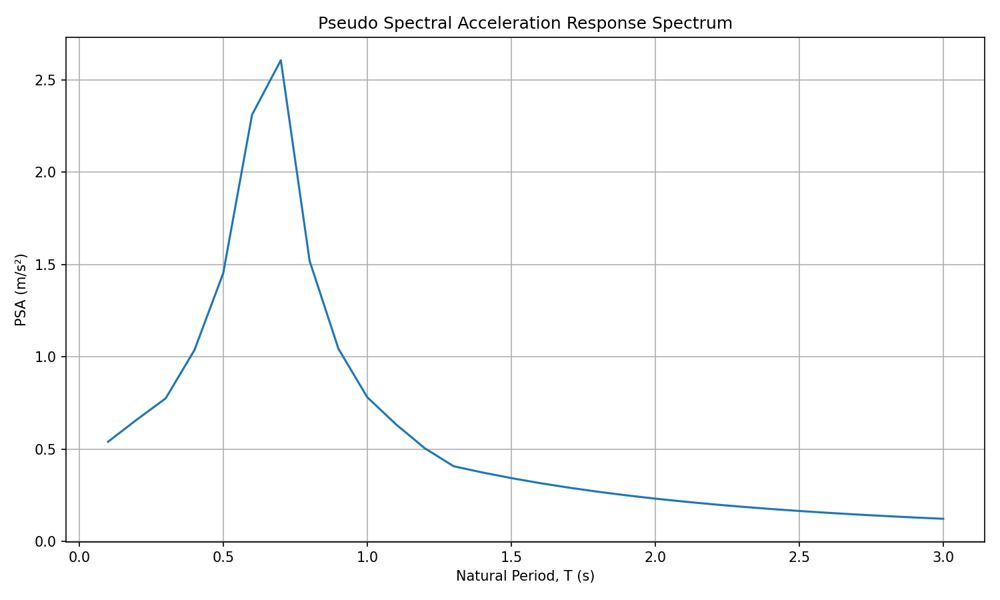
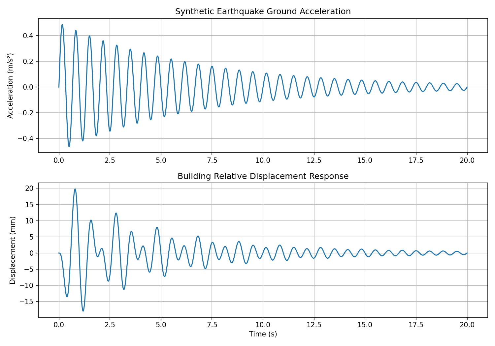

<div align="center">

# Seismic Field

### A live global earthquake map with structural response analysis

Track earthquake activity on NASA satellite imagery, inspect USGS event details, and explore a response spectrum from the project data.

[Open the live dashboard](https://muhammad-owais-khattak.github.io/seismic-response-spectra/)

[](https://github.com/Muhammad-Owais-Khattak/seismic-response-spectra/actions/workflows/deploy-pages.yml)
[](https://muhammad-owais-khattak.github.io/seismic-response-spectra/)
[](https://earthquake.usgs.gov/earthquakes/feed/)

</div>

---

## At a glance

Seismic Field brings a real-time earthquake catalog and a separate structural-response analysis into one browser dashboard. The map is the primary view; use **Events** to inspect individual earthquakes or **Density** to see magnitude-weighted event concentrations.

| Live monitoring | Structural analysis |
| --- | --- |
| Worldwide USGS events, refreshed every 60 seconds | PSA, PSV, and spectral displacement plots |
| NASA VIIRS true-color satellite imagery, with a no-key fallback | Included response-spectrum CSV or another compatible CSV |
| Past hour, 24 hours, 7 days, or 30 days | Period, response values, peak acceleration, and peak period |
| Event details, magnitude filters, and USGS ShakeMap images when published | Browser notifications for new events above a selected magnitude |

## Visuals

| Pseudo-spectral acceleration response spectrum | Synthetic ground motion and structural response |
| --- | --- |
| [](results/response_spectrum.png) | [](results/first_simulation.png) |
| Example peak: **2.61 m/s² at 0.70 s** in the included spectrum CSV. | This figure shows a **synthetic** input and simulated relative displacement; it is not a recorded earthquake. |

## Live map and event imagery

- **Earthquake feed:** USGS GeoJSON summary feeds provide event time, magnitude, location, and depth. The feed is refreshed every 60 seconds.
- **Satellite view:** NASA GIBS VIIRS corrected-reflectance imagery is used when available. Satellite imagery is near-real-time, not a second-by-second live camera feed. A NASA Blue Marble layer remains underneath as a fallback.
- **ShakeMaps:** selecting a significant event loads its USGS intensity image when that event has a published ShakeMap. Not every event has one.
- **Event density:** the Density mode weights map points by event magnitude. The magnitude filter affects both the map and the event list.
- **No map API key:** the map and public data feeds do not require a user API key.

### Notifications

Choose a minimum magnitude and select **Enable alerts**, then allow notifications in the browser prompt. Alerts are for newly reported global events and work while the dashboard is open. If permission was previously blocked, allow notifications in the browser's site settings and reload. Background push alerts after the page is closed are not included; those require a push service and server-side credentials.

## Response-spectrum data

The dashboard reads [`results/response_spectrum.csv`](results/response_spectrum.csv). The live earthquake catalog does **not** contain ground-motion acceleration records, so the plotted response spectrum is not calculated from current USGS events. Use **Load CSV** to inspect a different spectrum.

CSV files need these columns:

| Column | Meaning | Unit |
| --- | --- | --- |
| `period_s` | Oscillator natural period | seconds |
| `sd_m` | Spectral displacement | metres |
| `psv_m_per_s` | Pseudo-spectral velocity | metres per second |
| `psa_m_per_s2` | Pseudo-spectral acceleration | metres per second squared |

The included graph reaches approximately **2.61 m/s² at a period of 0.70 s**. See [`validation/test_forced_vibration.py`](validation/test_forced_vibration.py) for the separate numerical forced-vibration check.

## Run locally

```bash
git clone https://github.com/Muhammad-Owais-Khattak/seismic-response-spectra.git
cd seismic-response-spectra
python3 -m http.server 8000
```

Open [http://localhost:8000](http://localhost:8000). An internet connection is needed for the live feed, satellite imagery, and externally hosted map/chart libraries.

## Deployment

GitHub Actions deploys the site to GitHub Pages whenever changes are pushed to `main`. The current deployment is available at [muhammad-owais-khattak.github.io/seismic-response-spectra](https://muhammad-owais-khattak.github.io/seismic-response-spectra/). Deployment workflow: [`deploy-pages.yml`](.github/workflows/deploy-pages.yml).

## Data sources

- [USGS Earthquake Hazards Program feeds](https://earthquake.usgs.gov/earthquakes/feed/)
- [USGS ShakeMap products](https://earthquake.usgs.gov/data/shakemap/)
- [NASA GIBS satellite imagery](https://www.earthdata.nasa.gov/eosdis/science-system-description/eosdis-components/gibs)
- [Natural Earth country boundaries](https://www.naturalearthdata.com/)